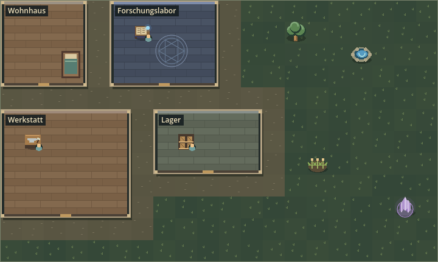
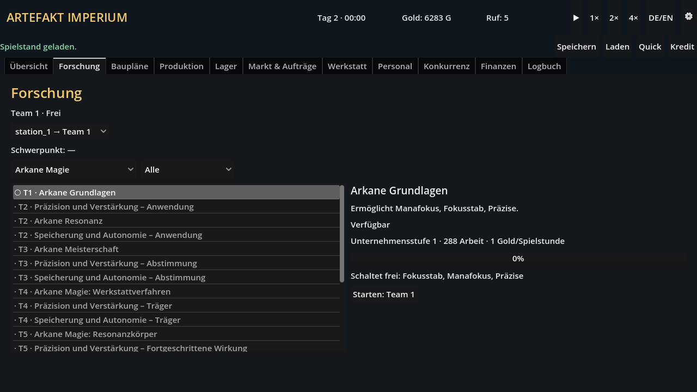
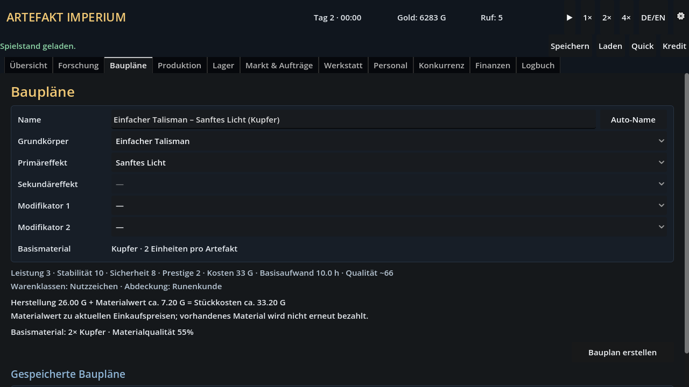
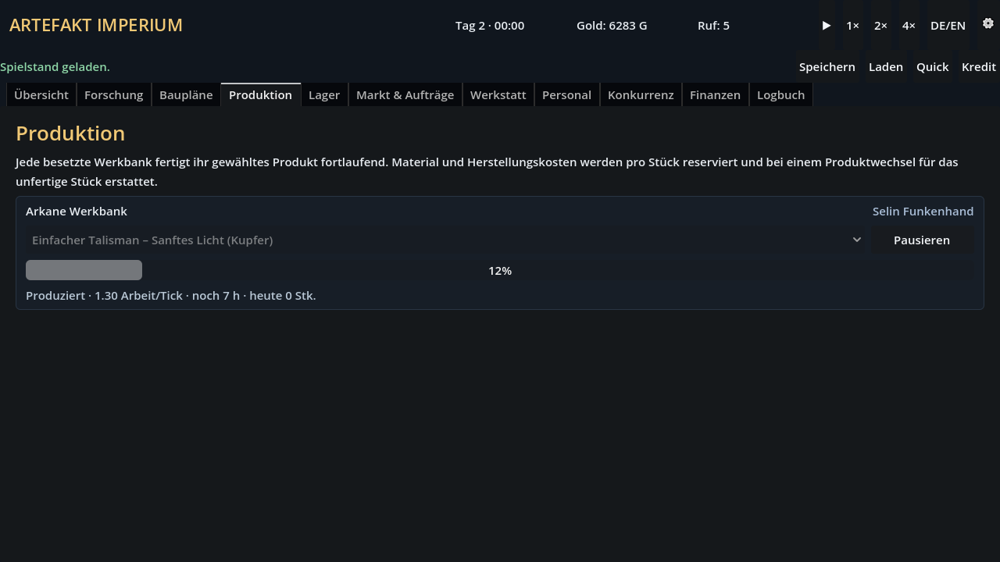

# Artefakt Imperium

Datengetriebener Fantasy-Tycoon **0.3.1** für **Godot 4.7.1**: sechs Magieschulen, 156 Forschungen und drei langfristige Unternehmenspfade.

Baue eine magische Werkstatt auf, erforsche neue Möglichkeiten und entwirf eigene Artefakte. Weise Personal zu, organisiere die Produktion und verkaufe deine Waren, um dein Unternehmen auszubauen.

## Einblicke ins Spiel

**Werkstatt aufbauen:** Räume, Arbeitsplätze und Rohstoffquellen bilden deinen Betrieb. Die vollständige Werkstattkarte zeigt hier das Startgrundstück am Stadtrand.



**Magie erforschen:** Wähle eine Magieschule, vergleiche Voraussetzungen und Freischaltungen und weise deinem Forschungsteam ein Projekt zu.



**Artefakte entwerfen:** Kombiniere Grundkörper, Effekte und Modifikatoren zu eigenen Bauplänen. Materialbedarf, Eigenschaften und Stückkosten siehst du direkt in der Vorschau.



**Produktion organisieren:** Besetzte Werkbänke fertigen den zugewiesenen Bauplan fortlaufend. Die Produktionsansicht zeigt Personal, Fortschritt und verbleibende Arbeitszeit.



Die Aufnahmen stammen aus Version 0.3.1. Die Oberfläche ist auf Deutsch und Englisch verfügbar.

## Design-Dokumente

- [Forschung und Unternehmensfortschritt 0.3](docs/FORSCHUNG_UND_FORTSCHRITT.md)
- [Grundkonzept](ARTEFAKT_IMPERIUM_CONCEPT.md)
- [Bewertung der zusätzlichen Ideen](docs/IDEENBEWERTUNG.md)
- [Priorisierter Ausbauplan](docs/ROADMAP.md)
- [Grundstücke und Rohstoffquellen](docs/GRUNDSTUECKE_UND_ROHSTOFFE.md)

## Start

### Direkt unter Windows

Wenn ein lokaler Windows-Build vorhanden ist, `Artefakt Imperium starten.bat` doppelklicken. Der Build liegt im Ordner `build`.

Die Startdatei verwendet den zuletzt exportierten Build. Nach Quellcodeänderungen den Windows-Build aktualisieren:

```powershell
& './Godot_v4.7.1-stable_mono_win64/Godot_v4.7.1-stable_mono_win64_console.exe' --headless --path . --export-release 'Windows Desktop' 'build/Artefakt Imperium.exe'
```

Fehlen die Exportvorlagen, kann bei einer vorhandenen EXE derselben Godot-Version das separate Spielpaket aktualisiert werden:

```powershell
& './Godot_v4.7.1-stable_mono_win64/Godot_v4.7.1-stable_mono_win64_console.exe' --headless --path . --export-pack 'Windows Desktop' 'build/Artefakt Imperium.pck'
```

Alternativ den aktuellen Quellstand direkt mit der lokalen Engine starten:

```powershell
& './Godot_v4.7.1-stable_mono_win64/Godot_v4.7.1-stable_mono_win64.exe' --path .
```

Das Repository enthält Quellcode, Spielinhalte, Tests und Dokumentation. Godot, exportierte Builds und lokale Testspielstände werden nicht mit versioniert. Nach dem Klonen Godot 4.7.1 installieren und das Projekt im Editor öffnen. Die PowerShell-Beispiele setzen die entpackte Windows-Engine im angegebenen Projekt-Unterordner voraus; bei anderer Installation `$godotExe` entsprechend anpassen.

### Im Godot-Editor

1. Godot 4.7.1 öffnen.
2. `project.godot` importieren.
3. Projekt mit `F6`/`F5` starten.

Die Simulation läuft in festen Stunden-Ticks. Pause und 1×/2×/4× befinden sich rechts oben. Elara startet am Forschertisch, Selin an der Werkbank und Torben als Lagerist am Materialregal. Der erste sinnvolle Ablauf ist:

1. Eine Grundlagenforschung starten.
2. Nach Abschluss im Bauplan-Editor ein Artefakt entwerfen.
3. Einen Bauplan einer besetzten Werkbank zuweisen, die kontinuierliche Produktion starten und die Ware am Markt anbieten.
4. Fachaufträge erfüllen und Unternehmensstufen freischalten. Später eröffnen weitere Grundlagen auch die Aufträge anderer Schulen.
5. Im Forschungsbereich Schule und Status wählen, Voraussetzungen und Freischaltungen vergleichen und Prototypen nach abgeschlossener Theorie gezielt abgeben.
6. Einen Betriebsschwerpunkt wählen, ab Unternehmensstufe 3 ein zweites Team erforschen und Forschertische zuweisen.
7. Ein Lebenswerk als Meister, Kaufmann oder Forscher abschließen und anschließend weiterspielen.

Die neue Inhaltsversion benötigt einen **Neustart**. Normales Speichern verwendet `manual_0_3_1`, `quick_0_3_1` und `autosave_0_3_1`; frühere Slots werden nicht überschrieben. Die Startauswahl zeigt vorhandene alte Slots weiterhin an und erklärt ihre Inkompatibilität beim Laden.

Die Werkstattkarte zeigt Räume als offene Gebäude mit Böden und Mauern. Bildsymbole kennzeichnen Arbeitsplätze und Rohstoffquellen; kleine Figuren zeigen zugewiesenes Personal. Mit dem Mauszeiger erscheinen Namen, Raumgrößen, Personal oder Quellenvorräte. Der Schalter **Bauraster** blendet die Zellgrenzen ein; während des Aufziehens oder Vergrößerns eines Raums erscheinen sie automatisch. Bodenmuster, Wege und Einrichtung sind rein dekorativ und belegen keine zusätzlichen Bauplätze.

## Headless-Tests

```powershell
$godotExe = Join-Path (Get-Location) 'Godot_v4.7.1-stable_mono_win64/Godot_v4.7.1-stable_mono_win64_console.exe'
# Nur für diese PowerShell-Sitzung: eigene Testspielstände und keine Nutzermods.
$env:APPDATA = Join-Path (Get-Location) '.test_user\local_tests'
$env:LOCALAPPDATA = Join-Path $env:APPDATA 'local'
New-Item -ItemType Directory -Force -Path $env:APPDATA | Out-Null
New-Item -ItemType Directory -Force -Path $env:LOCALAPPDATA | Out-Null
& $godotExe --headless --path . --import
& $godotExe --headless --path . --script tests/test_runner.gd
# Exitcode 0 und keine Parser-/Skriptfehler erwarten.
$LASTEXITCODE
```

Die Tests prüfen Contentvalidierung, deterministische Simulation, Forschung, Freischaltungen, Baupläne, Produktion, Markt, Spielstand-Roundtrip und Werkstattkollisionen. `tests/test_safety.gd` ergänzt Regressionen für beschädigte Spielstände und Mods, Wiederherstellung nach Speicherfehlern, begrenzte Nachfrage und reservierte Herstellungskosten. Projektmods unter `res://mods` werden weiterhin geladen.

Für einen gerenderten UI-Test mit Bauplanerstellung, Produktionsstart, Speichern/Laden und Sprachumschaltung in derselben isolierten Sitzung:

```powershell
& $godotExe --path . --script tests/test_ui_smoke.gd
```

Der UI-Test benötigt einen Grafikrenderer, prüft bei 1280 × 720 und schreibt Kontrollbilder einschließlich Forschungsansicht, Unternehmensfortschritt, Prototypenauswahl und Werkstattkarten nach `user://ui_smoke`; die vollständigen Pfade stehen in der Ausgabe. Für alle drei Grundstücke prüft er außerdem Bauraster, zweisprachige Detailhinweise sowie Raum-, Stations- und Größenänderungen über die Kartenbedienung. Die Bilder anschließend auf Lesbarkeit prüfen. Die Test-PowerShell danach schließen, damit spätere normale Spielstarts wieder das übliche Benutzerverzeichnis verwenden.

## Längere Aufstiegsprüfung

In derselben isolierten Testsitzung lassen sich alle drei Siegpfade ausschließlich mit normalen Spielbefehlen durchspielen:

```powershell
& $godotExe --headless --path . --script tests/test_progression_balance.gd
# Optional ein einzelner Pfad:
& $godotExe --headless --path . --script tests/test_progression_balance.gd -- master
```

Die Ergebnisse und Testspielstände liegen unter dem isolierten `user://balance` beziehungsweise `user://saves`. Gemeldete Stunden entsprechen laufender Simulation bei 1×, nicht gemessener menschlicher Spielzeit. Die Strategie investiert in Produktion, erfüllt Aufträge und nutzt später zwei Teams.

## Produktionskosten und Markt

Jeder Grundkörper hat ein festes Basismaterial; ein Artefakt verbraucht zwei Einheiten. Die Materialauswahl und Zusatzmaterial entfallen. Effekte und Modifikatoren ändern das Basismaterial nicht. Komplexe Baupläne schalten weiterhin Sekundäreffekte frei.

Pro begonnenem Stück werden Material und Herstellungskosten gemeinsam reserviert. Herstellungskosten ergeben sich aus Grundkörper, Effekten und Modifikatoren; vorhandenes Material wird nicht noch einmal bezahlt. Der zugeordnete Lagerist kauft fehlendes Material automatisch ein. Ohne Lageristen kann die Produktion nur vorhandene Vorräte verwenden. Reicht das Gold für Beschaffung und Herstellung zusammen nicht aus, beginnt das Stück nicht und der Bestand bleibt unverändert.

Pause erhält die Reservierung. Ein Produktwechsel erstattet Material und Herstellungskosten des unfertigen Stücks einmalig; gekaufte Rohstoffe bleiben dabei Rohstoffe. Nach Fertigstellung sind die Herstellungskosten verbraucht. Die Bauplananzeige trennt Herstellung und Materialwert zu aktuellen Einkaufspreisen. Der Tagesabschluss enthält Herstellungsausgaben abzüglich Erstattungen; die Prognose schätzt sie anhand des letzten Tages.

Kaufbereitschaft sinkt bei hohen Preisen weiter bis zu ausbleibenden Verkäufen. Alle Angebote teilen sich die Tagesnachfrage eines Kundensegments; der Marktanteil kann 100 % nicht überschreiten.

Im Lager zeigt jeder Rohstoff Bestand, freie Plätze und Qualität zusammen an. Kauf- und Verkaufspreise je Einheit werden getrennt angezeigt; aktive Marktereignisse erscheinen vollständig unter dem jeweiligen Rohstoff. Ein Status erklärt die Lagerbesetzung. Manuelle Käufe und Verkäufe entfallen: Der Lagerist sammelt täglich aus den Grundstücksquellen, lagert die Ernte ein und verkauft nur neue Überschüsse oberhalb der Kapazität. Vorhandene Vorräte werden nicht automatisch verkauft. Ohne Lagerbesetzung ruhen Beschaffung, Sammlung und Überschussverkauf.

## Spielstände und Wiederherstellung

Speicherformat **11** lädt nur Partien dieser Erweiterung mit exakt passender Paket-/Versionsliste. Frühere Speicherformate werden ohne Konvertierung und ohne Änderung der laufenden Partie abgewiesen. Forschungsgruppen, Schwerpunktwechsel, wartende Prototypen, Aufstiegszähler, Verkaufsfenster und alle erreichten Siege werden gespeichert.

Beim Speichern wird zuerst eine temporäre Datei geschrieben und zurückgelesen. Vor dem Ersetzen bleibt die letzte geprüfte Fassung als `<slot>.json.bak` erhalten. Fehlt die Hauptdatei oder ist sie beschädigt, lädt das Spiel diese Sicherung und meldet die Wiederherstellung. Temporäre Dateien werden nicht als Spielstände geladen. Bei inkompatiblen Paketen oder Speicherformaten erfolgt kein stiller Rückgriff auf einen älteren Stand. Ein abgelehnter Ladevorgang verändert die laufende Partie nicht.

Die Speicherung ist mit Wiederherstellung abgesichert; eine atomare Dateiersetzung oder Schutz gegen beliebige Datenträgerfehler wird nicht zugesichert.

## Architektur

- `src/core/content_registry.gd`: Paket-, Mod- und Referenzvalidierung.
- `src/core/game_simulation.gd`: Godot-szenenunabhängige Tick-Simulation und Fachsysteme.
- `src/core/game_command.gd`: typisierte Eingabebefehle.
- `src/core/save_system.gd`: geprüfte Spielstanddateien mit Sicherung und Wiederherstellung.
- `src/core/save_validation.gd`, `src/core/data_schema.gd`: Struktur-, Werte- und Referenzprüfung vor Spielstandmigrationen sowie gemeinsame Datentypprüfung für Content.
- `src/ui/main.gd`: zweisprachige Managementoberfläche.
- `content/base`: Grundspiel als Datenpaket.
- `mods/example`: ausführbares Beispiel für ein reines Daten-/Asset-Mod.

## Modpakete

Mods können unter `res://mods/<paket>` oder `user://mods/<paket>` liegen. Ein Paket benötigt `manifest.json` und `data.json`. IDs müssen mit dem Paketnamespace beginnen, beispielsweise `mein_mod:neuer_effekt`. Abhängigkeiten, Priorität und ausdrücklich erlaubte Überschreibungen stehen im Manifest. Jeder modifizierte oder neue Grundkörper benötigt `base_material_id` mit einer gültigen Material-ID. Die Content-Kompatibilität und die mitgelieferten Paketversionen sind 0.3.0. GDScript aus Mods wird nicht geladen.

Der Spielstand enthält die exakte Paket- und Versionsliste. Bei einer abweichenden Modliste wird das Laden sicher verweigert.
